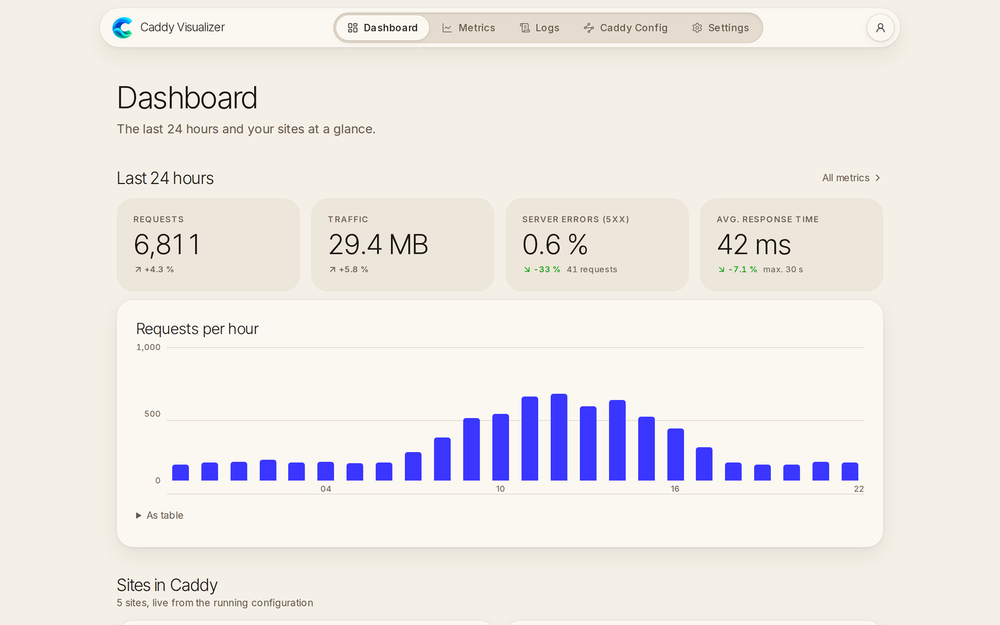
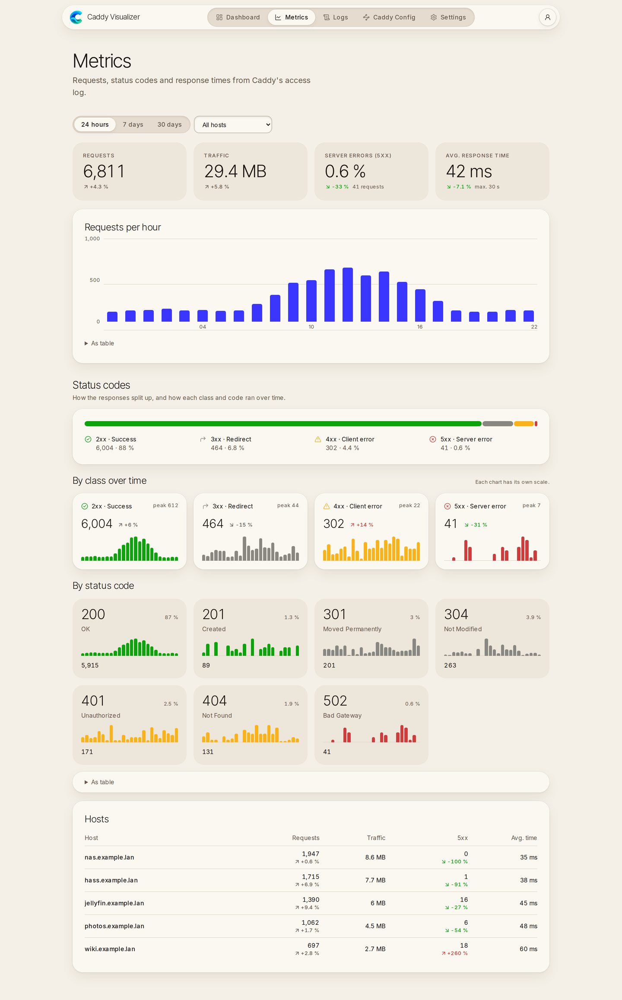
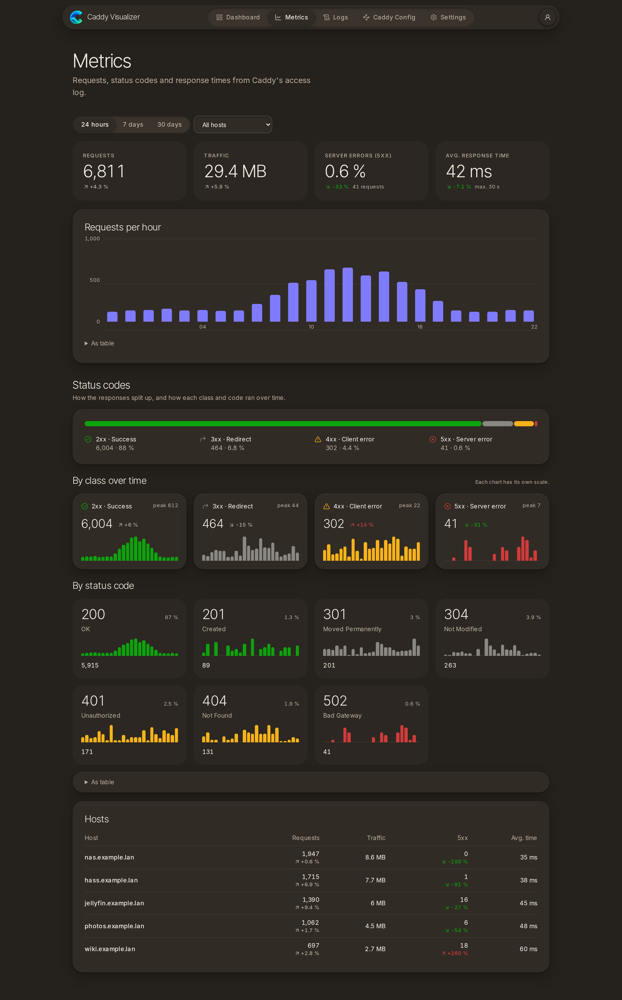
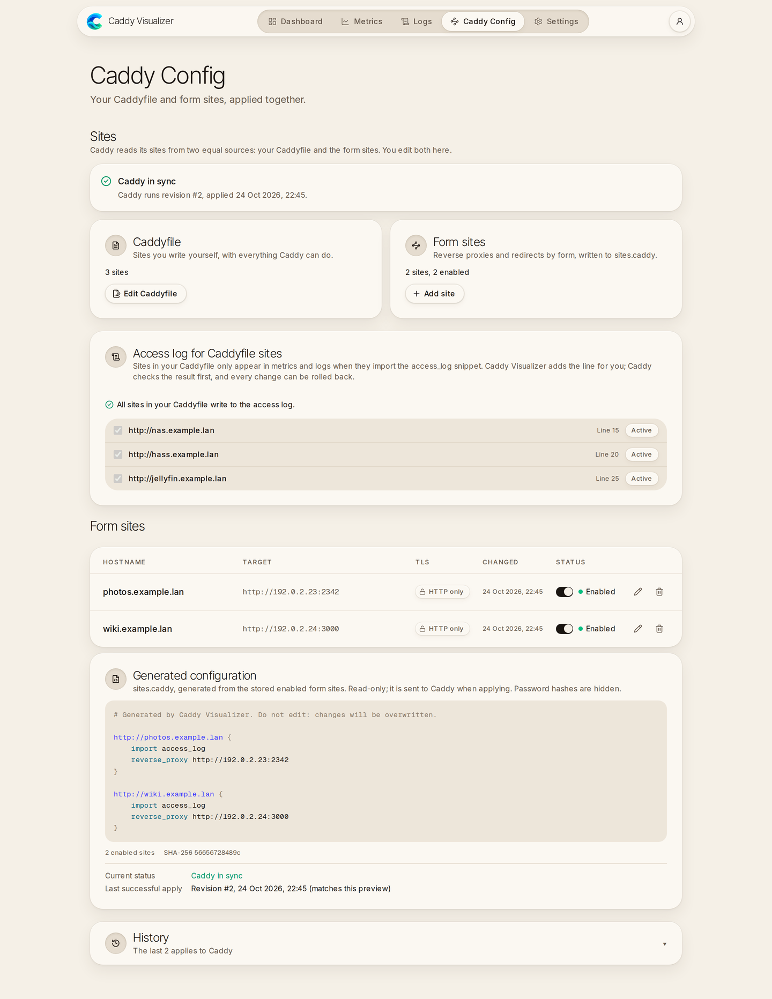
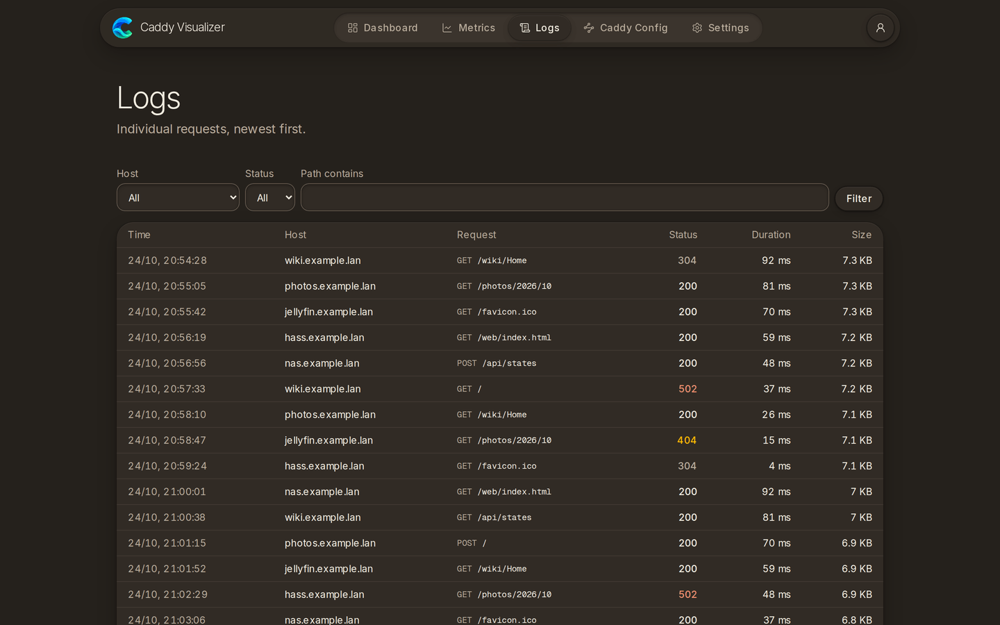

<p align="center">
  
</p>

<h1 align="center">Caddy Visualizer</h1>

<p align="center">
  Web UI for a <a href="https://caddyserver.com">Caddy</a> server in Docker: edit the Caddyfile,
  add reverse proxies, see sites, metrics and logs.
</p>



<table>
  <tr>
    <td></td>
    <td></td>
  </tr>
  <tr>
    <td></td>
    <td></td>
  </tr>
</table>

## Requirements

Linux on amd64, Docker Engine 26+ with Compose 2.26+, and Caddy 2.8+ in Docker with a named
volume at `/config` and the Caddyfile mounted at `/etc/caddy/Caddyfile`.

## Setup

**1. Prepare Caddy** (once). Create the folders in Caddy's config volume:

```sh
docker run --rm -v caddy_caddy_config:/config alpine sh -c '
  mkdir -p /config/manager /config/admin /config/logs && touch /config/manager/sites.caddy &&
  chown -R 1000:1000 /config/manager && chown 0:1000 /config/admin &&
  chmod 750 /config/admin && chmod 755 /config/logs'
```

Add to your Caddyfile, then allow UID 1000 to write it and restart Caddy:

```caddyfile
{
	admin unix//config/admin/admin.sock|0222
}

# Optional, for metrics and logs: add `import access_log` to each site.
(access_log) {
	log {
		output file /config/logs/access.log {
			mode 644
		}
		format json
	}
}

# … your sites …

import /config/manager/sites.caddy
```
Optional, for metrics and logs: add `import access_log` to each site:
```sh
sub.example.com {
  import access_logs
  reverse_proxy 10.10.10.10:8080
}
```


```sh
sudo setfacl -m u:1000:rw /path/to/Caddyfile && docker restart caddy
```

**2. Configure.** Download two files and fill in `.env`:

```sh
mkdir caddy-visualizer && cd caddy-visualizer
curl -fsSLO https://raw.githubusercontent.com/dree007/caddy-visualizer/main/docker-compose.yml
curl -fsSL https://raw.githubusercontent.com/dree007/caddy-visualizer/main/.env.example -o .env
```

**3. Start.**

```sh
docker compose up -d
```

Open `http://SERVER-IP:3000` and log in. Then remove `ADMIN_INITIAL_PASSWORD` from `.env`
and run `docker compose up -d` again.

## Update

```sh
docker compose pull && docker compose up -d
```

## Notes

- `ALLOW_INSECURE_LAN_HTTP=true` sends the password unencrypted: use it only in a trusted
  network and never expose port 3000 to the internet. Over HTTPS (e.g. through Caddy) set it to
  `false`.
- Settings shows _No read permission_ for the access log? Caddy created the file before
  `mode 644` was set: `docker exec caddy chmod 644 /config/logs/access.log`
- Forgot the password? Set a new `ADMIN_INITIAL_PASSWORD` plus `ADMIN_RESET_PASSWORD=true`,
  run `docker compose up -d`, then remove both lines.

## License

[MIT](LICENSE)
