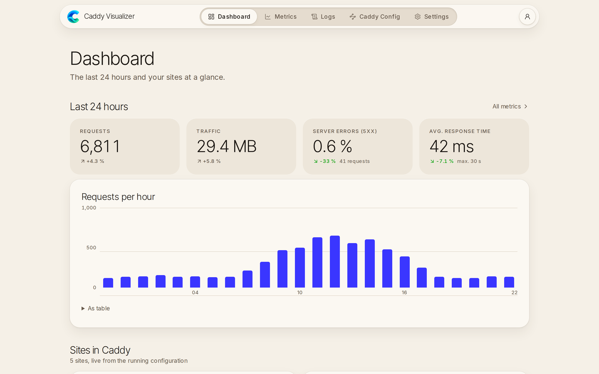
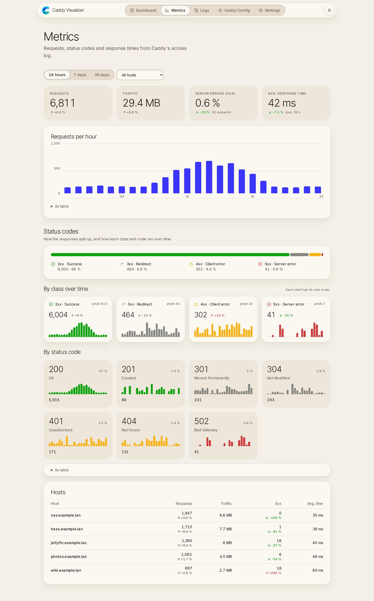
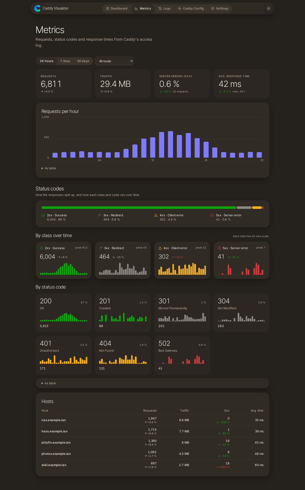
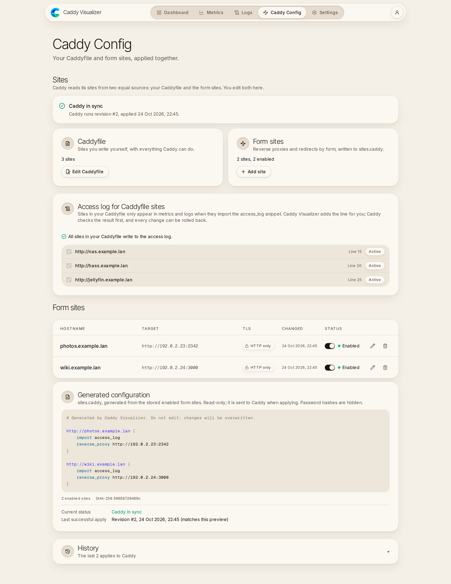
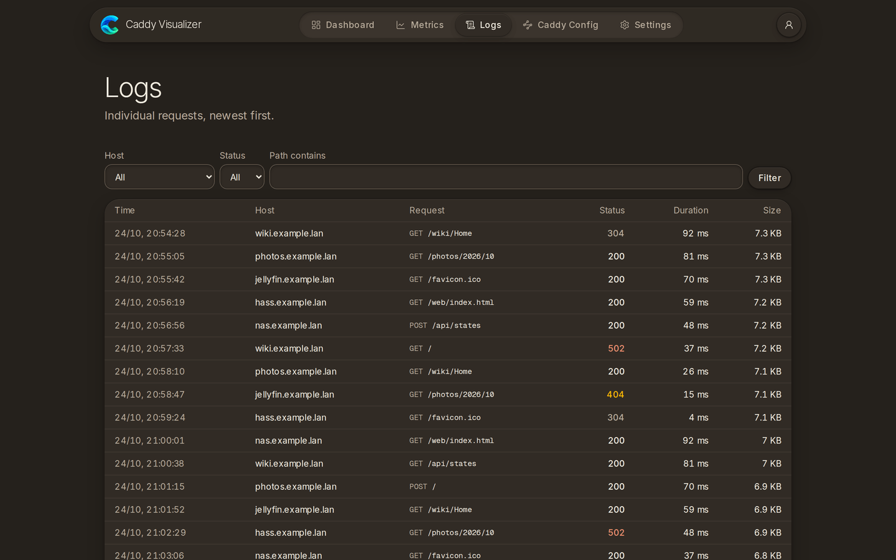

<p align="center">
  
</p>

<h1 align="center">Caddy Visualizer</h1>

<p align="center">
  Web UI for a <a href="https://caddyserver.com">Caddy</a> server in Docker: edit the Caddyfile,
  add reverse proxies, see sites, metrics and logs.
</p>



<table>
  <tr>
    <td></td>
    <td></td>
  </tr>
  <tr>
    <td></td>
    <td></td>
  </tr>
</table>

## Features

- **Caddyfile editor**: edit the main Caddyfile in the browser. Caddy checks it before anything
  is saved; you see its message with line numbers and a diff.
- **Sites by form**: reverse proxies and redirects without writing Caddyfile syntax, with
  optional basic auth, upstream headers and self-signed HTTPS upstreams.
- **Safe changes**: every change is checked and applied through Caddy's admin API, recorded as a
  revision and can be rolled back. Files are only written after Caddy accepted the change.
- **Dashboard**: all sites Caddy currently runs, from the form or the Caddyfile.
- **Metrics and logs**: requests, status codes, traffic and response times from Caddy's access
  log, with trends against the previous period. No IP addresses or query strings are stored.
- **Certificates**: status and expiry of the TLS certificate of every HTTPS site, with warnings
  before it expires.
- **Built-in login** with a single admin account, or login handled by your reverse proxy
  (Authelia, Authentik, oauth2-proxy).
- **Small footprint**: one container, SQLite, no Docker socket. English and German, light and
  dark theme, works on phones.

## Requirements

Linux on amd64, Docker Engine 26+ with Compose 2.26+, and Caddy 2.8+ in Docker with a named
volume at `/config` and the Caddyfile mounted at `/etc/caddy/Caddyfile`.

## Setup

**1. Prepare Caddy** (once). Create the folders in Caddy's config volume:

```sh
docker run --rm -v caddy_caddy_config:/config alpine sh -c '
  mkdir -p /config/manager /config/admin /config/logs && touch /config/manager/sites.caddy &&
  chown -R 1000:1000 /config/manager && chown 0:1000 /config/admin &&
  chmod 750 /config/admin && chmod 755 /config/logs'
```

Add to your Caddyfile, then allow UID 1000 to write it and restart Caddy:

```caddyfile
{
	admin unix//config/admin/admin.sock|0222
}

# Optional, for metrics and logs: add `import access_log` to each site.
(access_log) {
	log {
		output file /config/logs/access.log {
			mode 644
		}
		format json
	}
}

# … your sites …

import /config/manager/sites.caddy
```

```sh
sudo setfacl -m u:1000:rw /path/to/Caddyfile && docker restart caddy
```

**2. Enable the access log** (optional, for metrics and logs). Add `import access_log` to each
site in your Caddyfile:

```caddyfile
example.com {
	import access_log
	reverse_proxy app:8080
}
```

Restart Caddy afterwards, or do this step later in Caddy Visualizer under Caddy Config, which
adds the line to the selected sites. Sites you create in Caddy Visualizer get it automatically.

**3. Configure.** Download two files and fill in `.env`:

```sh
mkdir caddy-visualizer && cd caddy-visualizer
curl -fsSLO https://raw.githubusercontent.com/dree007/caddy-visualizer/main/docker-compose.yml
curl -fsSL https://raw.githubusercontent.com/dree007/caddy-visualizer/main/.env.example -o .env
```

**4. Start.**

```sh
docker compose up -d
```

Open `http://SERVER-IP:3000` and log in. Then remove `ADMIN_INITIAL_PASSWORD` from `.env`
and run `docker compose up -d` again.

## Login by a reverse proxy

By default (`AUTH_DISABLED=false`) the built-in login is on. If a reverse proxy already signs you in
(Authelia, Authentik, oauth2-proxy …), `AUTH_DISABLED=true` turns the built-in login off.

> [!WARNING]
> Only enable this option when every request is authenticated by a trusted reverse proxy and direct
> access to the application is blocked. Without the login, anyone who reaches port 3000 controls
> Caddy.

In `.env`: `AUTH_DISABLED=true` and `BIND_ADDRESS=127.0.0.1`; remove `ALLOW_INSECURE_LAN_HTTP` and
the `ADMIN_*` lines. The app refuses to start with `AUTH_DISABLED=true` on any other `BIND_ADDRESS`
or together with `ALLOW_INSECURE_LAN_HTTP=true`. It cannot see other published ports or whether the
proxy really authenticates: that is your part.

Then put the authentication in front of the app in the Caddyfile (Caddy runs with host networking,
so both are on `127.0.0.1`):

```caddyfile
visualizer.example.com {
	forward_auth 127.0.0.1:9091 {
		uri /api/authz/forward-auth
		copy_headers Remote-User Remote-Groups Remote-Email Remote-Name
	}
	reverse_proxy 127.0.0.1:3000
}
```

`forward_auth` stands before `reverse_proxy` in the same block, so it covers every path, including
`/api/*` and form submissions. The endpoint depends on the system: Authelia
`/api/authz/forward-auth` (port 9091), Authentik `/outpost.goauthentik.io/auth/caddy` (its outpost),
oauth2-proxy `/oauth2/auth` (port 4180; see its Caddy example for the sign-in redirect). The copied
headers are for the proxy's own use; Caddy Visualizer ignores them.

If your proxy runs in a Docker network instead, publish no port at all
(`docker-compose.override.yml` next to the compose file) and use `caddy-visualizer:3000` there:

```yaml
services:
  caddy-visualizer:
    ports: !reset []
    environment:
      BIND_ADDRESS: none
    networks: [proxy]
networks:
  proxy:
    external: true
```

Check after every change:

- [ ] `docker compose ps` shows `127.0.0.1:3000->3000/tcp` (or no port), never `0.0.0.0:3000`.
- [ ] From another computer, `curl -m 5 http://SERVER-IP:3000/` fails.
- [ ] `curl -I https://visualizer.example.com/settings` without signing in ends at the login of your
      proxy, not with `200`.
- [ ] No other site block, port or host name proxies to the app without `forward_auth`.
- [ ] Only trusted users and containers run on this host (they reach `127.0.0.1:3000`) and in the
      Docker network of the app.

Sign out at your proxy. Back to the built-in login: remove `AUTH_DISABLED` and add the `ADMIN_*`
lines as in the setup; the next start creates the admin if none exists yet.

## Update

```sh
docker compose pull && docker compose up -d
```

## Notes

- `ALLOW_INSECURE_LAN_HTTP=true` sends the password unencrypted: use it only in a trusted
  network and never expose port 3000 to the internet. Over HTTPS (e.g. through Caddy) set it to
  `false`.
- Settings shows _No read permission_ for the access log? Caddy created the file before
  `mode 644` was set: `docker exec caddy chmod 644 /config/logs/access.log`
- Certificates shows _Not applicable_ for an internal site? Its name resolves to a private
  address, which is only checked for domains listed in `CERT_CHECK_PRIVATE_DOMAINS`
  (e.g. `home.example.com,lan`). Certificates of an internal CA (`tls internal`) show as
  _Invalid_ unless that CA is added with `NODE_EXTRA_CA_CERTS`.
- Forgot the password? Set a new `ADMIN_INITIAL_PASSWORD` plus `ADMIN_RESET_PASSWORD=true`,
  run `docker compose up -d`, then remove both lines.

## License

[MIT](LICENSE)
